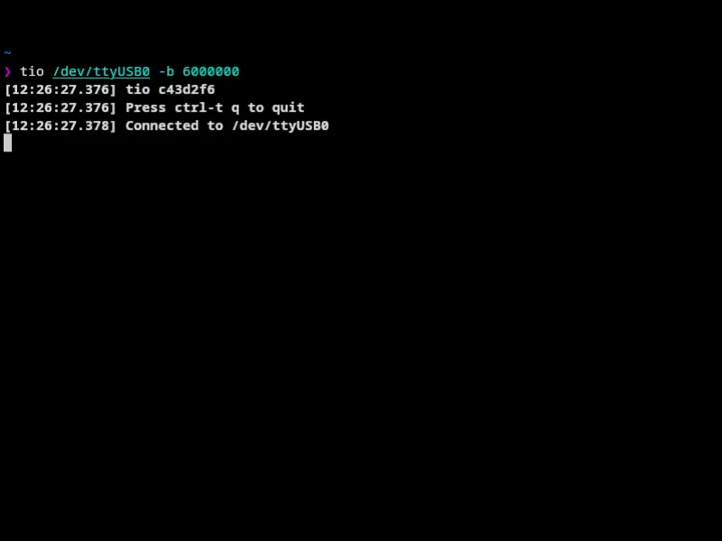

R&D department of the MediaTek MT6768... listen. i'm tired making readmes.
everything in this directory can be perfectly descripted with this gif:


btw, this is braille version of this gif played on the UART:




- src/asm.rs - assembler. use --help
- src/dis.rs - disassembler. feed it u64 hex for instruction disassembly
- src/sim.rs - gce simulator. use --help. runs linux faster than actual hw (lol)

boot to linux shell in ~190s: `cargo r --release --bin sim -- --input ../rv32_on_gce/kernel.bin --gce-base 0xf7600000 --guest ../linux/arch/riscv/boot/Image --guest-base 0xa8000000 --mem-size 0x2000000 --limit 50000000000`

demo:
```
     Running `target/release/sim --input ../rv32_on_gce/kernel.bin --gce-base 0xf7600000 --guest ../linux/arch/riscv/boot/Image --guest-base 0xa8000000 --mem-size 0x2000000 --limit 50000000000`
guest 7187116 bytes at 0xa8000000
gce 1493 insns base 0xf7600000 start 0xf7600000
[    0.000000] Linux version 7.3.0-rc6-00337-g3857c2fe5449-dirty (sudo@mkabacon) (ClangBuiltLinux clang version 22.1.5 (https://github.com/llvm/llvm-project.git 5ea218a153f4d2f815b8244eab3e4b4ba5e00e6c), ClangBuiltLinux LLD 22.1.5 (https://github.com/llvm/llvm-project.git 5ea218a153f4d2f815b8244eab3e4b4ba5e00e6c)) #23 PREEMPT Mon Oct 12 23:00:16 EEST 2026
[    0.000000] Machine model: MediaTek GCE v3
[    0.000000] earlycon: mtk8250 MMIO32:0x11002000 (options '')
[    0.000000] printk: legacy bootconsole [mtk8250] enabled
[    0.000000] OF: reserved mem: Reserved memory: No reserved-memory node in the DT
[    0.000000] Falling back to deprecated "riscv,isa"
[    0.000000] riscv: base ISA extensions aim
[    0.000000] riscv: ELF capabilities aim
[    0.000000] Ticket spinlock: enabled
[    0.000000] Zone ranges:
[    0.000000]   Normal   [mem 0x00000000a8000000-0x00000000a9ffffff]
[    0.000000] Movable zone start for each node
[    0.000000] Early memory node ranges
[    0.000000]   node   0: [mem 0x00000000a8000000-0x00000000a9ffffff]
[    0.000000] Initmem setup node 0 [mem 0x00000000a8000000-0x00000000a9ffffff]
[    0.000000] Kernel command line: earlycon=mtk8250,0x11002000 console=ttyGCE0,921600
[    0.000000] printk: log buffer data + meta data: 131072 + 409600 = 540672 bytes
[    0.000000] Dentry cache hash table entries: 4096 (order: 2, 16384 bytes, linear)
[    0.000000] Inode-cache hash table entries: 2048 (order: 1, 8192 bytes, linear)
[    0.000000] Built 1 zonelists, mobility grouping on.  Total pages: 8192
[    0.000000] mem auto-init: stack:all(zero), heap alloc:off, heap free:off
[    0.000000] SLUB: HWalign=64, Order=0-1, MinObjects=0, CPUs=1, Nodes=1
[    0.000000] NR_IRQS: 64, nr_irqs: 64, preallocated irqs: 0
[    0.000000] riscv-intc: 32 local interrupts mapped
[    0.000000] clocksource: jiffies: mask: 0xffffffff max_cycles: 0xffffffff, max_idle_ns: 19112604462750000 ns
[    0.000000] clint: clint@2000000: timer running at 13000000 Hz
[    0.000000] clocksource: clint_clocksource: mask: 0xffffffff max_cycles: 0xffffffff, max_idle_ns: 147020034397 ns
[    0.000608] sched_clock: 64 bits at 13MHz, resolution 76ns, wraps every 4398046511101ns
[    0.046869] Console: colour dummy device 80x25
[    0.055390] Calibrating delay loop (skipped), value calculated using timer frequency.. 26.00 BogoMIPS (lpj=130000)
[    0.064521] pid_max: default: 32768 minimum: 301
[    0.093129] Mount-cache hash table entries: 1024 (order: 0, 4096 bytes, linear)
[    0.097999] Mountpoint-cache hash table entries: 1024 (order: 0, 4096 bytes, linear)
[    0.139390] VFS: Finished mounting rootfs on nullfs
[    0.648866] Memory: 24876K/32768K available (4371K kernel code, 563K rwdata, 719K rodata, 1360K init, 195K bss, 7604K reserved, 0K cma-reserved)
[    0.715213] devtmpfs: initialized
[    0.958081] posixtimers hash table entries: 512 (order: 0, 2048 bytes, linear)
[    0.964168] futex hash table entries: 256 (3072 bytes on 1 NUMA nodes, total 3 KiB, linear).
[    1.537556] SCSI subsystem initialized
[    1.577121] clocksource: Switched to clocksource clint_clocksource
[    9.127341] workingset: timestamp_bits=14 (anon: 9) max_order=13 bucket_order=0 (anon: 4)
[   11.174373] Block layer SCSI generic (bsg) driver version 0.4 loaded (major 254)
[   11.710022] io scheduler mq-deadline registered
[   11.756891] io scheduler kyber registered
[   12.115411] io scheduler bfq registered
[  161.016767] Serial: 8250/16550 driver, 4 ports, IRQ sharing disabled
[  162.079544] 11002000.serial: ttyGCE0 MMIO32:0x11002000 (irq = 0, base_baud = 0) is a sudomkabacon
[  162.106327] printk: legacy console [ttyGCE0] enabled
[  162.106327] printk: legacy console [ttyGCE0] enabled
[  162.143457] printk: legacy bootconsole [mtk8250] disabled
[  162.143457] printk: legacy bootconsole [mtk8250] disabled
[  162.313282] mtk-uart-poll 11002000.serial: poll-mode UART at 0x11002000 (ttyGCE0)
[  165.016485] loop: module loaded
[  165.446221] null_blk: disk nullb0 created
[  165.466917] null_blk: module loaded
[  165.665959] mousedev: PS/2 mouse device common for all mice
[  165.757872] i2c_dev: i2c /dev entries driver
[  175.456166] Legacy PMU implementation is available
[  175.527383] clk: Disabling unused clocks
[  177.056418] Freeing unused kernel image (initmem) memory: 1360K
[  177.059462] This architecture does not have kernel memory protection.
[  177.063114] Run /init as init process
[  188.305661] random: crng init done
Saving 256 bits of creditable seed for next boot
Starting network: ip: socket: Function not implemented
ip: socket: Function not implemented
FAIL

~ #
```
